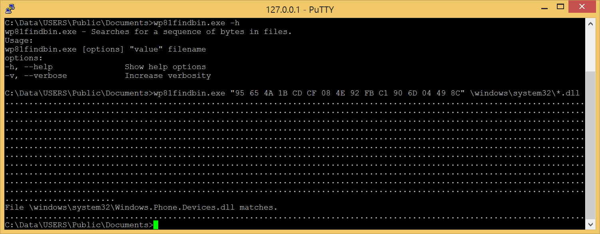

# Wp81FindBin

Like the [findstr](https://learn.microsoft.com/en-us/windows-server/administration/windows-commands/findstr) command of Windows Phone 8.1 but to find files containing a sequence of bytes.

## Usage



The sequence of bytes must be enclosed between double quotes, each byte must be in hexadecimal, separator is the space character.

```
wp81findbin [options] "value" filename
  -h, --help        Show help options
  -r, --recursive   Also search in subdirectories
  -v, --verbose     Increase verbosity
```

The absolute path of each matching file is printed.  
With `-r`, the filename pattern (e.g. `*.dll`) is applied in the given directory and in all its subdirectories:

```
wp81findbin -r "95 65 4A 1B CD CF 08 4E" C:\Windows\System32\*.dll
```
  
## Deployment

- [Install a telnet server on the phone](https://github.com/fredericGette/wp81documentation/tree/main/telnetOverUsb#readme), in order to run the application.  
- Manually copy the executable from the root of this GitHub repository to the shared folder of the phone.
> [!NOTE]
> When you connect your phone with a USB cable, this folder is visible in the Explorer of your computer. And in the phone, this folder is mounted in `C:\Data\USERS\Public\Documents`  

## Building

The tool is cross-compiled for ARM32 with clang-cl against the Windows Phone 8.1 SDK. It links only against `mincore.lib`.

### Requirements

- [CMake](https://cmake.org/) 3.20 or later
- [Ninja](https://ninja-build.org/)
- [LLVM](https://llvm.org/) with `clang-cl` and `lld-link`, installed in `C:\Program Files\LLVM`
- Windows Phone 8.1 SDK (`C:\Program Files (x86)\Windows Phone Kits\8.1`)
- Visual Studio 2012 Windows Phone SDK (`C:\Program Files (x86)\Microsoft Visual Studio 11.0\VC\WPSDK`)

If your tools are installed elsewhere, update the paths in [CMakeLists.txt](wp81findbin/CMakeLists.txt) and [CMakePresets.json](wp81findbin/CMakePresets.json).

### Build

```
cd wp81findbin
cmake --preset arm32-windows
cmake --build build
```

The executable is written to `wp81findbin/build/wp81findbin.exe`.
